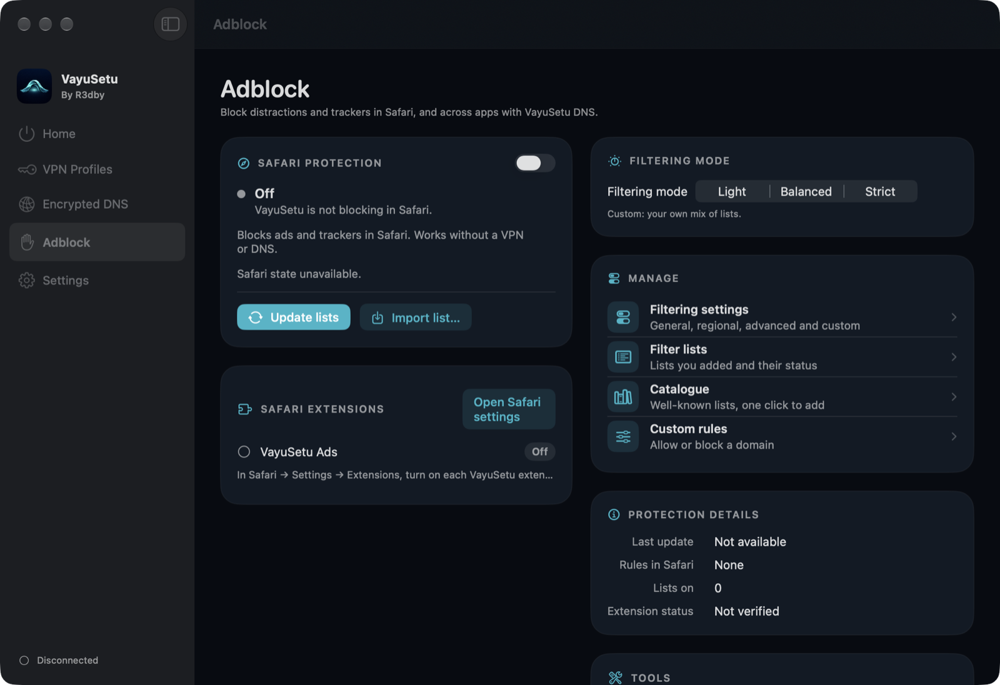

<p align="center"></p>

<h1 align="center">VayuSetu</h1>
<p align="center"><em>Your network. Your control.</em></p>

<p align="center">
  <a href="../../releases/latest"><b>Download for Mac</b></a> ·
  <a href="https://lokeshreddyveer.github.io/vayusetu/">Website</a> ·
  <a href="https://lokeshreddyveer.github.io/vayusetu/privacy.html">Privacy policy</a> ·
  <a href="https://lokeshreddyveer.github.io/vayusetu/support.html">Support</a>
</p>

**VayuSetu is a VPN client, an encrypted-DNS app and an ad blocker for iPhone and Mac, built to tell you the truth about what it is doing.**

It does not sell a VPN service and runs no servers of its own. You bring the WireGuard or IKEv2 server you already use, choose the encrypted DNS resolver you trust, and VayuSetu ties them together, blocks ads and trackers, and reports what it has actually observed instead of what you merely switched on.

- **No accounts, no analytics, no tracking.** Profiles, keys and settings stay on your device, with credentials in the system Keychain.
- **Three protections, one place.** VPN, encrypted DNS and Safari ad blocking can be used alone or combined.
- **Honest status.** A switch turns green only when VayuSetu has seen evidence that the protection works. Checks say what they observed, and what no app can prove.

> **Status.** VayuSetu 1.0 is working software under active development. The Mac build is signed and notarized by Apple. The iPhone app was submitted to App Review and is waiting on a store requirement: Apple only accepts VPN apps from an organization developer account, so the iPhone app's release path is being decided. VayuSetu has not had an independent security audit, and the tunnel has not yet been validated across every network transition. The newest Mac features (the network filter's lists, modes, map and connection card) are built and tested at the code level and are being proven in daily use; each is marked below. See [What VayuSetu cannot do](#what-vayusetu-cannot-do).

## Contents

[Download and install](#download-and-install) · [A tour of the app](#a-tour-of-the-app) · [The Mac network filter in depth](#the-mac-network-filter-in-depth) · [Keeping the Mac app healthy](#keeping-the-mac-app-healthy) · [Controlling VayuSetu from scripts](#controlling-vayusetu-from-scripts-and-shortcuts) · [How it works](#how-it-works) · [Privacy](#privacy) · [What VayuSetu cannot do](#what-vayusetu-cannot-do) · [Questions](#questions) · [Source code and license](#source-code-and-license) · [Support](#support) · [Credits](#credits-and-legal)

## Download and install

| Platform | Requirements | Status |
|---|---|---|
| **Mac** | macOS 14 or later, Apple Silicon or Intel | [Download the latest DMG](../../releases/latest). Developer ID signed and notarized by Apple. |
| **iPhone** | iOS 17 or later | Submitted to App Review; release is waiting on the organization-account requirement for VPN apps. |

**Installing on the Mac**

1. Open the DMG and drag **VayuSetu** into **Applications**.
2. Open VayuSetu. To run a VPN or encrypted DNS, macOS asks you to approve the VayuSetu network extension in **System Settings → General → Login Items & Extensions**. The network filter is a second, separate extension with its own approval.
3. To block ads in Safari, turn the VayuSetu extensions on in **Safari → Settings → Extensions**. There are six, so you can choose which categories to enable.
4. Add a VPN profile, a DNS resolver, or both, then press the power button.

Each release lists a SHA-256 checksum. To check your download, run `shasum -a 256` on the DMG and compare it with the checksum on the release page.

**First steps on either platform**

- **DNS and ad blocking only:** choose a resolver (the built-in *VayuSetu DNS* works at once), pick **DNS only** as the mode, and press power. No VPN server is needed.
- **With a VPN:** import your WireGuard file, paste its text, scan its QR code (iPhone) or add an IKEv2 server, then choose **VPN + DNS**.

## A tour of the app

Every picture is a real screenshot of VayuSetu, with its explanation beside it.

<table>
<tr>
<td width="260" valign="top"></td>
<td valign="top">

### Home: one button, three protections

The big power button starts and stops protection. Under it are three switches that you can combine freely:

- **VPN** tunnels your traffic through your WireGuard or IKEv2 server.
- **DNS** sends your lookups to an encrypted resolver, with filtering if you want it.
- **Adblock** turns on the Safari content blockers.

Tap the mode name to pick a ready-made combination: **VPN + DNS**, **VPN only**, **DNS only** or **Adblock only**. Below the button are the session timer, live **download and upload speed** and a seven-day chart of the requests VayuSetu's DNS filtering handled and blocked.

</td>
</tr>
</table>

<table>
<tr>
<td width="260" valign="top"></td>
<td valign="top">

### Bring your own VPN

VayuSetu does not sell VPN service. **Add a profile** accepts the server you already have:

- **Import** a WireGuard file, a copied configuration, or scan a **QR code** (iPhone).
- **Set up manually** with WireGuard, or add an **IKEv2/IPsec** server that uses Apple's native adapter.
- Keep several profiles and switch between them. A **backup profile** can be tried once, automatically, if the main one fails to connect.

Private keys and passwords go into the system Keychain. OpenVPN is not supported at the moment.

</td>
</tr>
</table>

<table>
<tr>
<td width="260" valign="top"></td>
<td valign="top">

### Clear confirmations

Anything that could interrupt your connection or delete something asks first. The button says exactly what will happen, destructive actions are red, and **Cancel** is always one tap away. On the iPhone it is a slide-up sheet that you can also drag down; on the Mac it is the standard system alert.

</td>
</tr>
</table>

<table>
<tr>
<td width="260" valign="top"></td>
<td valign="top">

### Filtering settings

Choose how aggressive blocking should be: **Light**, **Balanced** or **Strict**. Plain-language switches below turn real blocklists on or off: ads, tracking scripts, fingerprinting, telemetry, scams and ransomware, malicious sites, mining scripts, social buttons and cookie banners. The same rules go to Safari's content blockers and, when DNS is on, to DNS filtering. The status card says whether the rules were really applied.

</td>
</tr>
</table>

<table>
<tr>
<td width="260" valign="top"></td>
<td valign="top">

### A catalogue of filter lists

Add well-known lists with one tap, such as HaGeZi, OISD, AdGuard DNS filter, StevenBlack, Dan Pollock's hosts and EasyList. Each shows its size, what it is for, and whether you have added or enabled it. You can also add your own list by URL, import a file, and write **custom rules** that always allow or block a domain.

</td>
</tr>
</table>

<table>
<tr>
<td width="260" valign="top"></td>
<td valign="top">

### Six Safari content blockers

Safari limits how many rules one extension may hold, so VayuSetu splits blocking across six: **Ads, Privacy, Security, Social, Annoyances and Custom**. For each one this screen shows whether it is on in Safari, how many rules it holds, how much memory they take and when Safari last loaded them. You can rebuild all of them, or reload a single one.

</td>
</tr>
</table>

<table>
<tr>
<td width="260" valign="top"></td>
<td valign="top">

### Adblock test

Does it really work? The test requests real ad, tracker and analytics hosts twice, once without your rules and once with them, and reports how many were blocked, per category. Change the filtering level, Safari blocking or VayuSetu DNS and test again; **Past tests** lets you compare results over time. A site that is merely down is never counted as blocked.

</td>
</tr>
</table>

<table>
<tr>
<td width="260" valign="top"></td>
<td valign="top">

### Checks that are honest about their limits

**Run Available Checks** looks at what is really running: whether the tunnel is healthy, when the last WireGuard handshake happened, your public IPv4 and IPv6 addresses, whether DNS lookups reach the tunnel, resolution through your resolver, and whether a known ad domain is refused. Every row says what was observed, and the screen states what no app can prove, such as the absence of leaks from other apps. A manual **speed test**, a connection-quality test and a traffic view are included.

</td>
</tr>
</table>

<table>
<tr>
<td width="260" valign="top"></td>
<td valign="top">

### Privacy Lock

**Privacy Lock** keeps your traffic inside the tunnel: strict routing, connect on demand, automatic reconnect and an optional dual-stack WireGuard requirement. **Trusted Wi-Fi** networks can be exempted when Privacy Lock is off. If something goes wrong, **Temporarily Relax Privacy Lock** and **Emergency Reset** are right there. It says plainly that Privacy Lock is not an absolute kill switch, because the system keeps some exceptions of its own.

</td>
</tr>
</table>

<table>
<tr>
<td width="260" valign="top"></td>
<td valign="top">

### Settings and notifications

Permissions, protection modes, Privacy Lock, connect on launch and automatic reconnect. On the iPhone, **Dynamic Island notifications** briefly announce VPN connected or disconnected, DNS-only connected, and Adblock activated. The same screen leads to appearance and accessibility, Checks, logs, encrypted backup and restore, and the security centre. The iPhone also has a widget, Control Center controls (iOS 18) and Shortcuts for switching protection without opening the app.

</td>
</tr>
</table>

<table>
<tr>
<td width="420" valign="top"></td>
<td valign="top">

### VayuSetu for Mac

The Mac app is designed for the desktop, not stretched from the phone. A sidebar leads to **Home, VPN Profiles, Encrypted DNS, Adblock, Network and Settings**, and each page is a wide two-column layout with panels, tables, menus, hover states and right-click actions. It uses exactly the same engine as the iPhone app: the same profiles, the same DNS filter, the same Checks.

- **Home:** the power button and the three protections on the left; connection, live traffic, DNS activity and status on the right.
- **VPN Profiles:** a list with a details pane, connect, edit, duplicate, export without secrets, and QR export.
- **Encrypted DNS:** resolvers, a test, DNS activity, and an optional **Recent lookups** list (see below).
- **Adblock:** the six Safari extensions with their on/off state, whether Safari has loaded the rules, and how many of Safari's 150,000 rules each one uses.
- **Menu bar:** switches for VPN, Encrypted DNS and Adblock, a power item, and the network filter at a glance: allowed and blocked in the last minute, the latest blocks, connections waiting for you, and quick switches for the filter's mode and profile.
- **Keyboard:** ⇧⌘P turns protection on or off, ⇧⌘M opens the mode chooser.
- **System extensions:** the WireGuard tunnel and the network filter run as macOS system extensions, signed and notarized by Apple.
- **Network:** a firewall-style page that shows which apps connect where and lets you decide. It has its own section below.

The screenshot shows the Adblock page before Safari protection is switched on.

</td>
</tr>
</table>

## The Mac network filter in depth

The **Network** page is for people who want to know, and decide, what their Mac connects to. It is in the same spirit as tools such as Little Snitch, LuLu and TinyShield, and it follows the same rule as the rest of VayuSetu: **no servers, no accounts, no analytics**. Everything it learns stays on your Mac.

It is a separate macOS system extension that you approve once. It is part of the download from GitHub, not the Mac App Store build. Switch it on at the top of the page; switch it off there at any time. VayuSetu's own connections and loopback traffic are never filtered.

### What it can see, and what it cannot

For every new connection that an app opens, the filter knows **which app** (by its code signature, not just its name), the **team that signed it**, which program **started it** (for example Terminal for a command typed in a shell), the **destination** (a name when the app used one, otherwise the address), the **port** and the **protocol**. It can tell when an app's signer has **changed** since it was first seen, or when its signature is **invalid**, and flags both.

It decides at the moment a connection starts. It does not read the contents of your traffic, so it cannot see which web page or file you asked for.

### How a connection is decided

The same order every time, so the outcome is predictable:

1. VayuSetu's own traffic, and loopback, always pass.
2. **Block lists.** A destination on a block list is blocked for every app, unless one of your rules names that app and allows it.
3. **Your rules.** The most specific rule wins: a named app beats every app, an exact address beats a domain, a port and a direction add to it. At equal specificity a block beats an allow.
4. **Allow lists** let a destination through without a question.
5. **Apple-signed software** can be let through without a question (a switch you control). Command-line tools such as `curl`, `ssh` and `python` are never skipped, because anyone can run them.
6. **The mode** decides the rest.

### Three modes

| Mode | What it does with a connection no rule covers |
|---|---|
| **Ask me** | Pauses the connection and shows the connection card. Nothing is lost: it stays paused until you answer. You can instead let a timeout apply your default, for unattended Macs. |
| **Passive** | Never asks. Your rules and lists still apply, and new connections are allowed or blocked as you chose, optionally saving that choice as a rule for the app so the list builds itself. |
| **Block all** | Everything is blocked except what a rule or an allow list lets through. |

If the VayuSetu window is not available to answer (for example at login), the filter lets the connection through and records it, rather than leaving apps frozen.

### The connection card

When Ask me is on, a small card appears in the top-right corner, whichever page or Space you are on. It names the app and the destination, shows the protocol, port, country and who started the app, and has two buttons: **Block** and **Allow**. A one-second pause after it appears ignores stray keystrokes, so a Return you were typing elsewhere cannot answer it. **Options** lets you choose how far the answer reaches (this app anywhere, this domain, this server, or this server and port) and how long it lasts (once, an hour, until the filter restarts, or forever). **Later** sets the card aside; the connection stays paused and is still listed on the Network page and in the menu bar.

### Rules, groups and schedules

A rule names an app (or every app), a destination, a port and a direction. Destinations can be a name, a wildcard such as `*.example.com` (subdomains only), a pattern such as `ads*.example.com`, an exact address, an address block such as `10.0.0.0/8` or `fd00::/8`, or a range such as `10.0.0.1-10.0.0.50`. Rules can belong to **groups** that you switch on and off together (Work, Public Wi-Fi, Lockdown), can **expire** by themselves, and can run on a **weekly schedule**, including overnight windows. Each rule shows how many times it has been used and when last. Rules can be exported to a file and imported again.

### Block lists and allow lists

Add a list from a preset (a hosts list of ad and tracker names, a small list of ad servers, a list of malware hosts), from a web address that refreshes itself, or by pasting names. Hosts files, plain names, wildcards, address blocks and ad-blocker `||name^` lines are all understood. Lists refresh while VayuSetu is open. A list that cannot be refreshed keeps its old entries and says why. Up to 50 lists of up to 400,000 entries each are kept, and a lookup costs the same however long they are.

### Incoming connections

A setting decides what an app that **accepts** a connection gets when no rule covers it. This watches connections that apps accept; it is not a packet-level firewall, and it is not meant to replace the macOS firewall.

### The map and the traffic charts

The **Map** tab lays out where your connections go, the way a network monitor does: a list on the left that you can group by country or by app, over the last five minutes, the last hour, or everything recorded, and a world map on the right with a line from this Mac to each country, coloured green for allowed, red for blocked and orange for both. Click a row to light up its lines, or a country to see what connects there, with a **Block** button beside each connection. Countries are looked up from a database inside the app, so no address is ever sent to a lookup service. They are estimates, drawn to a country's centre, not to the server's exact place. The map tiles themselves load from Apple Maps.

The **Traffic** tab charts bytes sent and received per app and per minute. This is **off by default**: counting bytes means the filter reads the data of each allowed connection, which can slow heavy transfers, so you switch it on knowingly.

Because Bonjour and local-network chatter can fill a connection list, **Hide local network chatter** is on by default and can be turned off.

### Profiles

Save your current rules and settings as a named **profile** (Home, Work, Public Wi-Fi) and switch between them from the page or from the menu bar.

## Keeping the Mac app healthy

System extensions are installed by macOS, not by the app, and an old version can keep running after the app is updated. VayuSetu checks every 90 seconds which version of the tunnel and the network filter is installed against the version inside the app. When one is out of date, waiting for your approval, or switched off in System Settings, a banner appears on every page with one **Update now** button. Updating the tunnel disconnects it for a moment, and macOS may ask you to approve.

The DNS check does not stop at "the tunnel is up". It resolves a normal name and a name that is on your block lists, retries while the rules reach the tunnel, and says in plain words if the blocked name was **not** blocked.

If the Mac app ever crashes, it writes a short trace of function names (no personal data, nothing sent anywhere) to `~/Library/Logs/VayuSetu/`, because macOS does not always keep a crash report.

### Recent DNS lookups

On the Encrypted DNS page (and on the iPhone's DNS diagnostics) you can switch on **Keep a list of recent lookups**: the last few hundred names this device asked for, whether each was blocked, answered or failed, with search. It is **off by default**, held in the tunnel's memory only, never saved, and cleared when you switch it off. It works with the local DNS tunnel. DNS does not say which app asked, so this list cannot show that; the network filter is where you see apps.

## Controlling VayuSetu from scripts and shortcuts

On the Mac, links control the running app, from Terminal, Shortcuts or any script:

```sh
open "vayusetu://protection/dns/on"          # vpn, dns or adblock; on, off or toggle
open "vayusetu://network/profile/Work"       # apply a saved network-filter profile
open "vayusetu://network/mode/passive"       # normal, passive or blockall
```

On the iPhone, **Shortcuts** and **Siri** can turn DNS-only, VPN and ad blocking on and off.

## How it works

- **One engine, two apps.** The iPhone and Mac apps share the same logic: the store, the tunnel controller, the profile and DNS code, the filter engine and the Checks. Each platform has its own screens, and its own packet-tunnel extension built from the same tunnel code.
- **VPN.** WireGuard runs through the official WireGuard Apple adapter and `wireguard-go`. IKEv2 uses Apple's native adapter.
- **Encrypted DNS.** A small DNS runtime inside the tunnel answers lookups. It speaks DNS-over-HTTPS or DNS-over-TLS to the upstream resolver, keeps a short cache, checks CNAME chains so a tracker cannot hide behind a harmless-looking alias, and can fall back to a second encrypted resolver. DNS-only mode runs this runtime on its own, with no VPN server.
- **Filtering.** The enabled lists compile into a compact snapshot that the tunnel reads. Rules are allow or block, for a domain and its subdomains or for one exact name. An allow rule always beats a block rule, so Website Exceptions can switch filtering off for a whole site. The contract is written down in [DNS rule precedence](Docs/Architecture/DNS-Rule-Precedence.md) and pinned by tests.
- **Safari.** The same lists feed six Safari content-blocker extensions, split by category to stay within Safari's rule limits.
- **The Mac network filter** is a macOS content-filter system extension (`NEFilterDataProvider`). The app talks to it over a private XPC connection that accepts only VayuSetu itself, checked by code signature. Rules, lists, history and usage counts are kept by the extension, so the filter keeps working when the window is closed.
- **On the Mac, the tunnel runs as root.** It cannot read the file the app writes, so the app sends the compiled filter snapshot to the tunnel in a message when it connects and when your lists change. The tunnel keeps its own copy.
- **Evidence, not assumptions.** Protection states come from what the system and the tunnel report: the tunnel's status, the last handshake, counters that are still fresh, answered lookups, a lookup of a known-blocked name. Stale numbers are not evidence.

## Privacy

VayuSetu has no accounts, no analytics and no tracking, and it runs no servers. It contacts only the services that you or a feature you switch on need:

| When | Who it talks to |
|---|---|
| You connect | The VPN server and the DNS resolver you configured |
| Filter lists update | The list sources you enabled |
| You run a public-IP check | An IP-echo service such as ipify or ident.me |
| You run the speed test | Cloudflare's public speed servers (about 70 MB of data) |
| You look up who owns an address (optional, asks first) | RIPEstat |
| You run the adblock test | The ad and tracker hosts it tests, to see whether they are blocked |

Credentials live in the Keychain. Connection logs and traffic history are optional, stay on the device, and can be cleared at any time. Backups are encrypted with a password you choose. Read the full [privacy policy](https://lokeshreddyveer.github.io/vayusetu/privacy.html).

## What VayuSetu cannot do

- **It is not a VPN provider.** Without a server or profile of your own, only DNS and ad blocking are available.
- **A running tunnel is evidence, not proof.** An app that ignores the system DNS settings, or another VPN or filter running at the same time, can bypass any resolver. Checks tells you what it saw and what it can't see.
- **Privacy Lock is not an absolute kill switch.** Apple keeps some exceptions of its own.
- **"Resolve outside the VPN" is a trade-off.** If you switch it on, the connection to your resolver leaves the VPN; your network can see which resolver you use, though not the lookups. VayuSetu shows a warning when it is on.
- **Safari content blockers work only in Safari.** DNS filtering covers other apps that use the system DNS.
- **Dynamic Island notifications** can appear only while the iPhone app is open, because iOS allows nothing else.
- **The Mac network filter** sees new connections and can block them, but it is not a packet inspector: it does not read the contents of traffic. Like any app-level firewall it can be switched off by anyone who can change System Settings. Its rules, lists, modes and connection handling are covered by automated tests, and it works on a real Mac in daily use, but it has not been validated against heavy real-world traffic. Counting traffic reads the data of allowed connections and can slow heavy transfers, which is why it is off by default. Incoming-connection control covers connections that apps accept, not raw packets.
- **Country locations are estimates.** They come from an address database inside the app (IP Geolocation by DB-IP, CC BY 4.0), and a country's centre is not a server's place.
- **Other network tools can interfere.** If AdGuard, LuLu, another VPN or another content filter runs at the same time, DNS and connection filtering can be affected. Checks tells you what VayuSetu saw.
- **The recent-lookups list cannot name the app** that asked, because DNS does not carry that.
- **OpenVPN** is not supported. **Certificate-based IKEv2** is not yet available on the Mac. The Mac app has no QR-code scanner, widgets or Shortcuts actions; it has the `vayusetu://` links above instead.
- **Not independently audited.** The code is published for review, but VayuSetu has not had a third-party security audit, and the tunnel has not yet been validated against every network transition.

## Questions

**Do I need a VPN subscription?** Only if you want the VPN part. DNS-only mode and ad blocking work on their own.

**Does VayuSetu see my browsing?** No. It has no servers. DNS lookups go from your device to the resolver you chose, and the filter runs on your device.

**Why does the status say "not verified"?** Because VayuSetu will not say a protection works until it has seen evidence. Run the checks, or use the connection for a moment, and it updates.

**Will blocking break websites?** Sometimes, especially in Strict mode. Use **Website Exceptions** to turn blocking off for one site.

**Is the Mac network filter like Little Snitch?** It covers much of the same ground: it shows which app connects where, asks about new connections, and lets you block by app and destination, with lists, modes, a map and traffic charts. It is newer, it is not a packet inspector, and it has not had the years of real-world testing that those tools have. It has no servers, accounts or analytics.

**Will the connection card freeze my apps?** An unanswered question keeps that connection paused, which is the point of asking. If the VayuSetu window cannot answer, the filter lets the connection through. Use Passive mode if you do not want questions.

**Why does the app say a component needs updating?** macOS installs system extensions separately from the app. Press **Update now** to install the version that matches the app.

**Can I move my profiles to another device?** Yes: show a profile's QR code, or make an encrypted backup and restore it.

## Source code and license

The source is published here so you can read and review how VayuSetu works. It is **not open source**: it is proprietary, and copying, modifying, redistributing or reusing it is not permitted. See [LICENSE](LICENSE).

| Folder | What is in it |
|---|---|
| `ios/` | The iPhone app and its shared logic, packet tunnel, Safari extensions, tests and the Xcode project |
| `macos/` | The Mac app's screens, the network filter extension (`Filter/`), rule-engine and provider tests (`Tests/`, run with `tools/test-filter.sh`), the geolocation tooling, and the build, signing and notarization scripts. The country-lookup tables (`macos/Resources/Geo/*.bin`, from DB-IP) are not stored in git; `macos/scripts/build-geo.py` regenerates them from the public data it names |
| `Extensions/` | The Dynamic Island, widget and Control Center extensions |
| `Packages/VayuSetuCore/` | Core logic shared by both apps |
| `Docs/` | Architecture, security and design notes, including [DNS rule precedence](Docs/Architecture/DNS-Rule-Precedence.md) |

## Support

Questions, bug reports or feature requests: **contact@lokeshreddy.dev**, or see the [support page](https://lokeshreddyveer.github.io/vayusetu/support.html).

## Credits and legal

VayuSetu includes the WireGuard® Apple adapter and `wireguard-go` under their own licenses, the Public Suffix List, and filter lists published by their respective maintainers; the lists and their licenses are credited inside the app. WireGuard is a registered trademark of Jason A. Donenfeld. Apple, iPhone, Mac, Safari and Dynamic Island are trademarks of Apple Inc.

Copyright © 2026 Lokesh Reddy Veerabhadra. All rights reserved.
