

<h1 align="center">VayuSetu</h1>

<em>Your network. Your control.</em>

  <a href="../../releases/latest"><b>Download for Mac</b></a> ·
  <a href="https://lokeshreddyveer.github.io/vayusetu/privacy.html">Privacy policy</a> ·
  <a href="https://lokeshreddyveer.github.io/vayusetu/support.html">Support</a>

VayuSetu is a VPN client, encrypted-DNS app and ad blocker for iPhone and Mac. It does not sell a VPN service and has no servers of its own. You bring the WireGuard or IKEv2 server you already use, pick the encrypted DNS resolver you trust, and VayuSetu ties the two together, filters ads and trackers, and tells you plainly what it has and has not been able to verify.

It has no accounts, no analytics and no tracking. Everything it knows about you stays on your device.

## Download and install

| Platform | Requirements | Status |
|---|---|---|
| **Mac** | macOS 14 or later, Apple Silicon or Intel | [Download the latest DMG](../../releases/latest). Developer ID signed and notarized by Apple. |
| **iPhone** | iOS 17 or later | Coming to the App Store. |

**Installing on the Mac**

1. Open the DMG and drag **VayuSetu** into **Applications**.
2. Open VayuSetu. To run a VPN, macOS asks you to approve the VayuSetu network extension in **System Settings → General → Login Items & Extensions**.
3. To use the ad blockers in Safari, turn them on in **Safari → Settings → Extensions**. There are six, so you can choose which ones to enable.

The download page lists a SHA-256 checksum for the DMG, so you can confirm that the file is intact: `shasum -a 256 VayuSetu-1.0-13-macOS.dmg`.

## A tour of the app

Every picture below is a real screenshot of VayuSetu, with an explanation beside it.

<table>
<tr>
<td width="260" valign="top">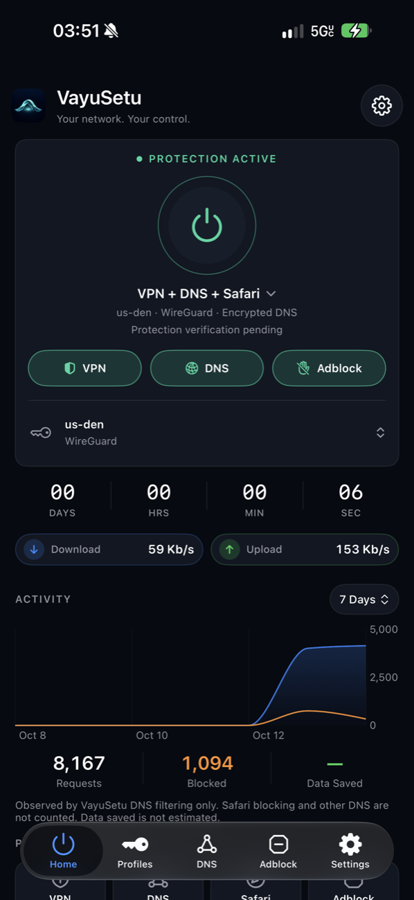</td>
<td valign="top">

### Home: one button, three protections

The big power button starts and stops protection. Under it are three switches that you can combine freely:

- **VPN** tunnels your traffic through your WireGuard or IKEv2 server.
- **DNS** sends your lookups to an encrypted resolver, with filtering if you want it.
- **Adblock** turns on the Safari content blockers.

Tap the mode name to pick a ready-made combination: **VPN + DNS**, **VPN only**, **DNS only** (no VPN server needed) or **Adblock only**. A switch turns green only when VayuSetu has seen evidence that it works, never just because you asked for it. Below the button you get the session timer, live **download and upload speed** and a seven-day **activity** chart of the requests VayuSetu's DNS filtering handled and blocked.

</td>
</tr>
</table>

<table>
<tr>
<td width="260" valign="top">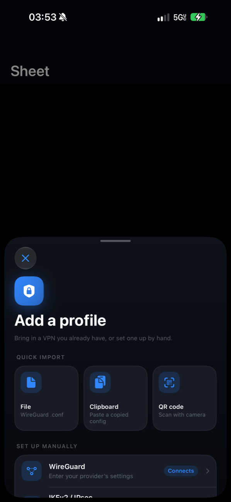</td>
<td valign="top">

### Bring your own VPN

VayuSetu does not sell VPN service. **Add a profile** accepts the server you already have:

- **Import** a WireGuard file, a copied configuration from the clipboard, or scan a **QR code**.
- **Set up manually** with WireGuard, or add an **IKEv2/IPsec** server that uses Apple's native adapter.
- Keep several profiles and switch between them. You can also choose a **backup profile** that VayuSetu tries once if the main one fails to connect.

Private keys and passwords go into the system Keychain, and configurations stay on the device. OpenVPN is not supported at the moment.

</td>
</tr>
</table>

<table>
<tr>
<td width="260" valign="top">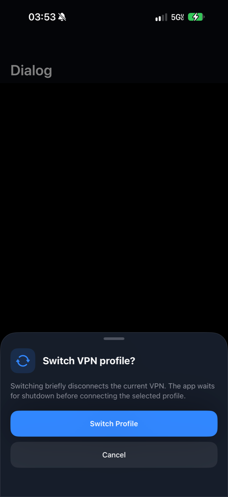</td>
<td valign="top">

### Clear confirmations

Anything that could interrupt your connection or delete something asks first, in the same slide-up sheet. The button says exactly what will happen (here, "Switch Profile"), destructive actions such as deleting a profile are red, and **Cancel** is always one tap away. You can also tap outside the sheet or drag it down to dismiss it.

</td>
</tr>
</table>

<table>
<tr>
<td width="260" valign="top">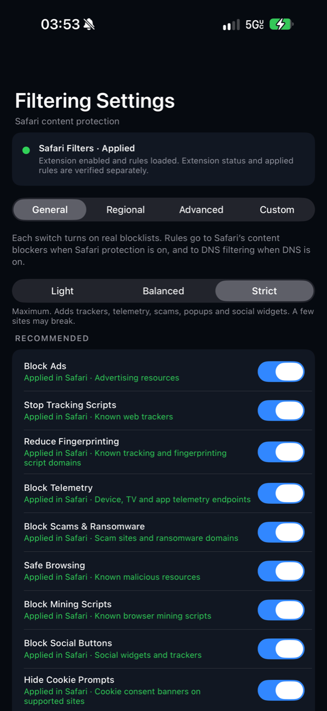</td>
<td valign="top">

### Filtering settings

Choose how aggressive blocking should be with three levels: **Light**, **Balanced** and **Strict**. Underneath, plain-language switches turn real blocklists on or off: ads, tracking scripts, fingerprinting, telemetry, scams and ransomware, malicious sites, mining scripts, social buttons and cookie banners. The same rules go to Safari's content blockers and, when DNS is on, to DNS filtering. The status card says whether the rules were actually applied.

</td>
</tr>
</table>

<table>
<tr>
<td width="260" valign="top">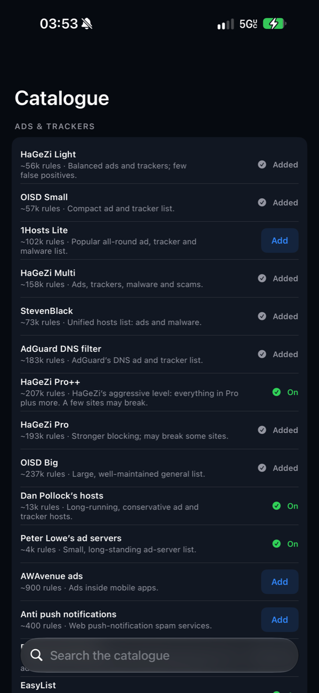</td>
<td valign="top">

### A catalogue of filter lists

Add well-known lists with one tap, such as HaGeZi, OISD, AdGuard DNS filter, StevenBlack, Dan Pollock's hosts and EasyList. Each one shows its size and what it is for, and whether you have added or enabled it. You can also add your own list by URL, import a file, and write **custom rules** that always allow or block a domain.

</td>
</tr>
</table>

<table>
<tr>
<td width="260" valign="top">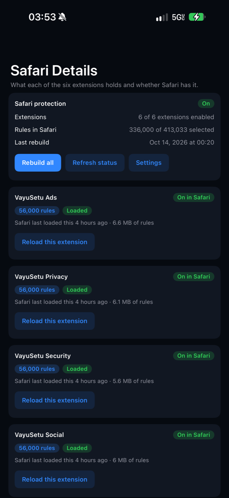</td>
<td valign="top">

### Six Safari content blockers

Safari limits how many rules one extension may hold, so VayuSetu splits blocking across six extensions: **Ads, Privacy, Security, Social, Annoyances and Custom**. This screen shows, for each one, whether it is on in Safari, how many rules it holds, how much memory they take and when Safari last loaded them. You can rebuild all of them, or reload a single one, from here.

</td>
</tr>
</table>

<table>
<tr>
<td width="260" valign="top">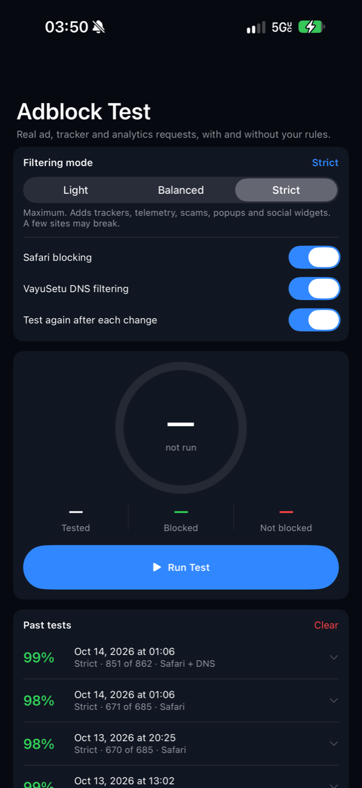</td>
<td valign="top">

### Adblock test

Does it really work? The test requests real ad, tracker and analytics hosts twice, once without your rules and once with them, and reports how many were blocked, per category. Switch the filtering level, Safari blocking or VayuSetu DNS and test again, and the **Past tests** list lets you compare results over time. It is careful about unreachable hosts, so a site that is simply down is not counted as blocked.

</td>
</tr>
</table>

<table>
<tr>
<td width="260" valign="top">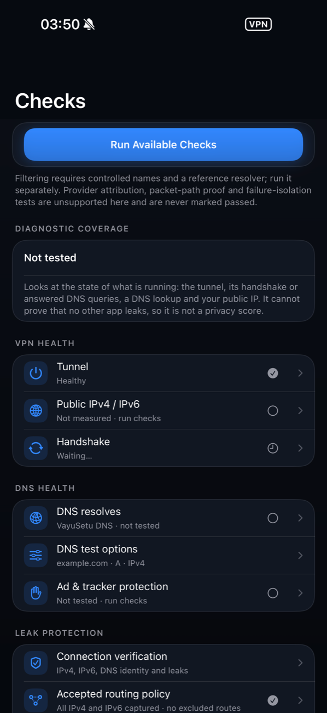</td>
<td valign="top">

### Checks that are honest about their limits

**Run Available Checks** looks at what is really running: whether the tunnel is healthy, when the last WireGuard handshake happened, your public IPv4 and IPv6 addresses, whether DNS lookups reach the tunnel, DNS resolution through your resolver, and whether a known ad domain is refused. Every row says what was observed, and the screen is clear about what no app can prove, such as the absence of leaks from other apps. There is also a manual **speed test**, a connection-quality test and a traffic view.

</td>
</tr>
</table>

<table>
<tr>
<td width="260" valign="top">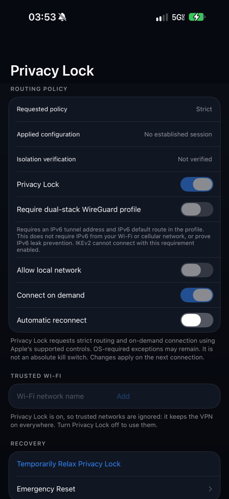</td>
<td valign="top">

### Privacy Lock

**Privacy Lock** keeps your traffic inside the tunnel: strict routing, connect on demand, automatic reconnect and an optional requirement for a dual-stack WireGuard profile. **Trusted Wi-Fi** networks can be exempted when Privacy Lock is off. If something goes wrong, **Temporarily Relax Privacy Lock** and **Emergency Reset** are right there. It says plainly that Privacy Lock is not an absolute kill switch, because iOS keeps some exceptions of its own.

</td>
</tr>
</table>

<table>
<tr>
<td width="260" valign="top">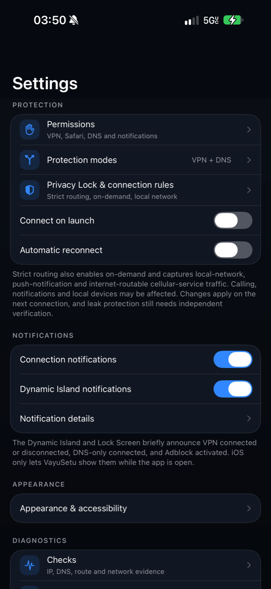</td>
<td valign="top">

### Settings and notifications

Permissions, protection modes, Privacy Lock and connection rules, connect on launch and automatic reconnect. **Dynamic Island notifications** briefly announce VPN connected or disconnected, DNS-only connected, and Adblock activated, and **Connection notifications** do the same as normal notifications. The same screen leads to appearance and accessibility, Checks, logs, backup and restore, and the security centre. There are also a widget, Control Center controls (iOS 18) and Shortcuts for switching protection without opening the app.

</td>
</tr>
</table>

<table>
<tr>
<td width="420" valign="top">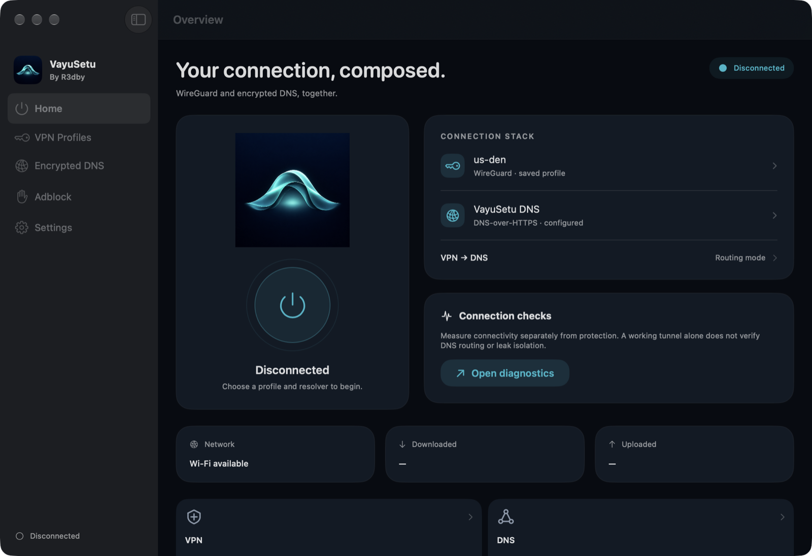</td>
<td valign="top">

### VayuSetu for Mac

The Mac app has the same engine with a desktop layout: a sidebar for **Home, VPN Profiles, Encrypted DNS, Adblock and Settings**, the connection stack (profile, resolver and routing mode), connection checks, and live network, download and upload tiles. A **menu-bar** control connects and disconnects, and the WireGuard tunnel runs as a system extension signed and notarized by Apple.

</td>
</tr>
</table>

## Privacy

VayuSetu has no accounts, no analytics and no tracking, and it runs no servers. It contacts only the services that you or a feature you switch on need:

| When | Who it talks to |
|---|---|
| You connect | The VPN server and the DNS resolver you configured |
| Filter lists update | The list sources you enabled |
| You run a public-IP check | An IP-echo service such as ipify or ident.me |
| You run the speed test | Cloudflare's public speed servers (about 70 MB of data) |
| You look up who owns an address (optional, asks first) | RIPEstat |
| You run the adblock test | The ad and tracker hosts it tests, to see whether they are blocked |

Read the full [privacy policy](https://lokeshreddyveer.github.io/vayusetu/privacy.html).

## What VayuSetu cannot do

- It is not a VPN provider. Without a server or profile of your own, only DNS and ad blocking are available.
- A running tunnel and a successful DNS lookup are evidence, not proof. An app that ignores the system DNS settings, or another VPN or filter running at the same time, can bypass any resolver. Checks tells you what it saw and what it can't see.
- iOS lets an app show Dynamic Island notifications only while the app is open, so changes made while VayuSetu is in the background are not announced.
- Safari content blockers work only in Safari. DNS filtering covers other apps that use the system DNS.

## How it is built

VayuSetu is written in Swift and SwiftUI. The iPhone and Mac apps share one set of screens and logic, and each platform has its own packet-tunnel extension. WireGuard runs through the official WireGuard Apple adapter and `wireguard-go`, with a small DNS filter added inside the tunnel. A shared Swift package holds the filter rules, parsers and policy code.

## Source code and license

The source is published here so you can read and review how VayuSetu works. It is **not open source**: it is proprietary, and copying, modifying, redistributing or reusing it is not permitted. See [LICENSE](LICENSE).

| Folder | What is in it |
|---|---|
| `ios/` | The iPhone app, its packet tunnel and Safari extensions, and the Xcode project |
| `macos/` | The Mac app, build and signing scripts |
| `Extensions/` | The Dynamic Island, widget and Control Center extensions |
| `Packages/VayuSetuCore/` | Shared core logic |
| `Docs/` | Architecture, security and design notes |

## Support

Questions, bug reports or feature requests: **contact@lokeshreddy.dev**, or see the [support page](https://lokeshreddyveer.github.io/vayusetu/support.html).

## Credits and legal

VayuSetu includes the WireGuard® Apple adapter and `wireguard-go` under their own licenses, the Public Suffix List, and filter lists published by their respective maintainers; the lists and their licenses are credited inside the app. WireGuard is a registered trademark of Jason A. Donenfeld. Apple, iPhone, Mac, Safari and Dynamic Island are trademarks of Apple Inc.

Copyright © 2026 Lokesh Reddy Veerabhadra. All rights reserved.
